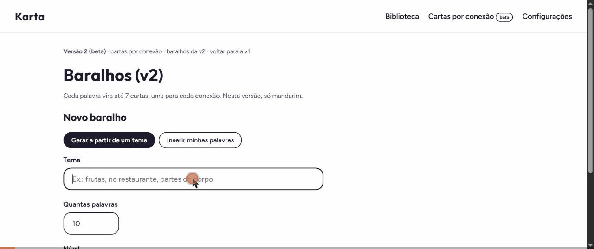
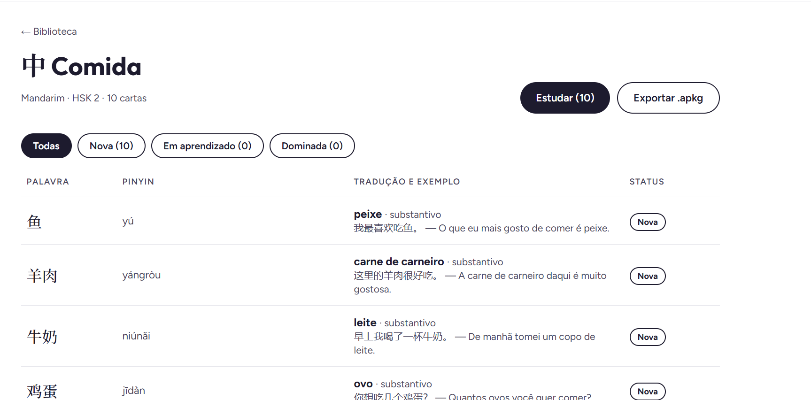
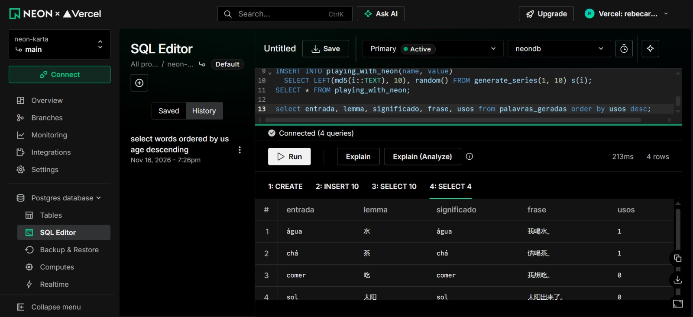

# Karta

Baralhos de flashcards de idiomas gerados por IA. Você escolhe o idioma, o nível e o tema. O Gemini monta as cartas com pronúncia, tradução e uma frase de exemplo no nível certo, e o app agenda as revisões por repetição espaçada.

**[Abrir o Karta →](https://karta-nine-beta.vercel.app)** · funciona no navegador, sem instalar nada · [diário de construção](docs/processo.md)

> **Status:** publicado. A v1 (geração com IA, modo estudo, áudio e exportação para o Anki) está completa. A **v2, cartas por conexão**, está em beta no mesmo site, no menu "Cartas por conexão".



| Baralho gerado pelo Gemini | Modo estudo |
|---|---|
|  |  |

## Origem
O Karta começou como uma nova interface para o [Agente_Flashcards_Mandarim](https://github.com/SanchesPinto/Agente_Flashcards_Mandarim), pipeline em Python de **Gabriel Pinto** (OpenAI, Pexels, edge-tts e genanki). O escopo vem desse projeto: cartas com pinyin e frase de exemplo, áudio separado para palavra e frase, exportação para o Anki e, numa branch de junho/2026, suporte a inglês e francês com configuração por idioma.

O código original do Gabriel está preservado em [`v1-python/`](v1-python), com o histórico completo dos commits dele neste repositório. O Karta reescreveu a implementação do zero como app web, sem reaproveitar código: trocou os provedores pelo Gemini, chegou a 5 idiomas e acrescentou modo estudo com repetição espaçada, modelos reserva e diagnóstico. A comparação completa está no [diário](docs/processo.md#origem-o-projeto-do-gabriel).

## Autoria
| Quem | O quê |
|---|---|
| **Rebeca** | Produto, design das telas, implementação (com IA), testes e documentação |
| **Gabriel Pinto** | Pipeline original em Python ([`v1-python/`](v1-python)), que deu origem ao projeto; coautor da [arquitetura modular da v2](docs/arquitetura/) |
| **CauanGS** | [Modelagem de dados por facetas e pontes](docs/modelagem/), base do modelo de dados da v2 |

## v2 · Cartas por conexão (beta)
Na v1, cada palavra vira uma carta. Na v2, cada palavra vira um conjunto de **facetas** (o caractere, o significado, uma frase, o áudio), e cada carta treina **uma conexão** entre duas delas: ver o caractere e lembrar o significado, ouvir e reconhecer, completar a lacuna de uma frase. São até 7 cartas por palavra, cada uma com o próprio agendamento.

```
Modo A: tema ─▶ Módulo 1 (IA escolhe as palavras) ─▶ você revisa ─┐
                                                                   ├─▶ Módulo 2 (IA gera as facetas) ─▶ Módulo 3 (código monta as cartas)
Modo B: suas palavras ─▶ porta de entrada ────────────────────────┘
```

- **A IA não decide sozinha:** no modo A, nenhuma carta é criada antes de você revisar, editar ou acrescentar palavras.
- **A IA é conferida por fontes externas e por código:** cada palavra é checada na lista oficial do HSK (o protótipo mostrou a IA trocando 西瓜 por caracteres parecidos que existem, mas estão errados); a posição da lacuna é calculada pelo código, não pela IA.
- **O Módulo 3 não usa IA:** as cartas saem de um catálogo de 7 conexões, sem custo nem variação.
- **Repetição espaçada com FSRS** ([ts-fsrs](https://github.com/open-spaced-repetition/ts-fsrs)), o algoritmo que o Anki oferece desde 2023, com dados no IndexedDB do navegador.
- **Áudio opcional por baralho**, que dá para ligar e desligar depois sem perder o histórico; em Configurações a pessoa escolhe de onde vem a voz: gravações do Gemini, voz do navegador ou as duas.
- **Banco de palavras compartilhado** (Postgres no Neon): uma palavra gerada por alguém fica no banco e é reaproveitada por todos, sem gastar a cota do Gemini de novo.
- **Contas (Google ou e-mail) e baralhos no banco:** com login, baralhos e progresso ficam no Postgres e aparecem em qualquer aparelho; sem login, tudo continua funcionando no navegador.
- **Exporta para o Anki** (`.apkg`): uma nota por palavra e um tipo de cartão por conexão, com as gravações dentro do pacote e a voz do sistema do Anki como plano B.
- **O baralho continua editável:** acrescentar palavras (digitando ou pedindo à IA), corrigir sem perder o histórico de estudo, gerar uma palavra de novo e excluir em massa.

O banco de palavras visto por dentro: "água" e "chá" foram geradas uma vez e reaproveitadas por outro baralho (`usos = 1`), sem nova chamada ao Gemini.



A arquitetura foi desenhada com Gabriel Pinto ([`docs/arquitetura`](docs/arquitetura/)), sobre a modelagem de dados de CauanGS ([`docs/modelagem`](docs/modelagem/)). As decisões e o que deu errado no caminho estão no [diário](docs/processo.md).

## Por que existe
Montar um baralho bom de vocabulário dá trabalho: escolher as palavras do nível, conferir a pronúncia e achar uma frase de exemplo que não use palavras mais difíceis que a própria carta. O Karta faz essa parte em segundos e deixa a pessoa só estudar.

## O que este projeto mostra
| Habilidade | Onde ver |
|---|---|
| Engenharia de prompt | [`lib/prompt.js`](lib/prompt.js): instrução de sistema, regras por idioma e schema de saída |
| Saída estruturada e validação | Schema JSON imposto ao modelo + [`lib/validar.js`](lib/validar.js) |
| Orquestração de modelos com resiliência | [`app/api/gerar/route.js`](app/api/gerar/route.js): novas tentativas, modelos reserva, tempo limite |
| API sem backend próprio | Rotas `/api` que viram funções serverless; cada visitante usa a própria chave, então a cota do projeto não é exposta |
| Diagnóstico de problemas reais | [`scripts/diagnostico.mjs`](scripts/diagnostico.mjs), os 6 problemas do [primeiro teste](docs/processo.md#dia-2-1411-as-telas-e-o-primeiro-teste-real) e o [chiado causado por um certificado C2PA](docs/processo.md#dia-2-à-tarde-1411-áudio) |
| Do design ao produto | [Mockups](docs/design) que viraram as telas reais |
| Testes automáticos | [`scripts/testar-apkg.mjs`](scripts/testar-apkg.mjs) (formato do Anki, v1 e v2), [`scripts/testar-v2.mjs`](scripts/testar-v2.mjs) (95 verificações da v2) e [`scripts/testar-srs.mjs`](scripts/testar-srs.mjs) (repetição espaçada) |
| Pipeline de IA em etapas, com uma pessoa no meio | v2: [Módulo 1](lib/v2/modulo1.js) → revisão → [Módulo 2](lib/v2/modulo2.js) → [Módulo 3](lib/v2/pontes.js), cada um com uma responsabilidade |
| Validar a IA com fonte externa | [`lib/v2/dados/hsk.js`](lib/v2/dados/hsk.js), gerado da lista oficial do HSK por [`scripts/baixar-hsk.mjs`](scripts/baixar-hsk.mjs) |
| Banco de dados e custo de IA | [`lib/v2/bancoPalavras.js`](lib/v2/bancoPalavras.js) e [`bancoPalavrasPostgres.js`](lib/v2/bancoPalavrasPostgres.js): palavras já geradas vêm do Postgres em vez de uma nova chamada ao Gemini |
| Arquitetura que permite trocar o armazenamento | [`lib/v2/adaptadores.js`](lib/v2/adaptadores.js): navegador e servidor com as mesmas operações; os mesmos testes do repositório rodam nos dois |
| Segurança de dados por usuário | [`lib/v2/dadosServidor.js`](lib/v2/dadosServidor.js): usuário vindo da sessão, filtro em toda consulta, sem sobrescrever dado alheio, sem injeção de SQL (com testes) |
| Protótipo antes de construir | [`scripts/prototipo-modulo2.mjs`](scripts/prototipo-modulo2.mjs) mediu qualidade, custo e tempo de dois modelos antes da escolha |

## Como funciona

```
Navegador                    Servidor (função serverless)                 Gemini
─────────                    ────────────────────────────                 ──────
Formulário ── POST ──▶  /api/gerar
                        1. valida o pedido
                        2. monta o prompt  ──────────────────────────────▶ modelo principal
                           (se sobrecarregado: espera e tenta de novo;     │ ou reserva
                            depois passa para o modelo reserva)            │
                        3. recebe o JSON   ◀───────────────────────────────┘
                        4. remove cartas repetidas ou incompletas
Salva no   ◀── JSON ──
navegador
    │
    ▼
Estudo: a repetição espaçada decide quando cada carta volta
```

## Decisões principais

| Decisão | Por quê |
|---|---|
| Gemini | Camada gratuita, texto e voz no mesmo provedor |
| Modelos em variáveis de ambiente | Modelos são aposentados e ficam sobrecarregados. Trocar não exige mexer no código |
| Erro 503 e falha de rede: nova tentativa. Erro 401 e 429: para | Só repete o que esperar resolve |
| `localStorage` em vez de banco | MVP sem login. Limite: os dados ficam num navegador só |
| Repetição espaçada própria (v1) | Regra simples e explicável: errou, volta na hora; acertou com segurança, o intervalo cresce 2,5× |
| FSRS (v2) | Com até 7 cartas por palavra, o agendamento precisa ser preciso; o FSRS é o algoritmo que o Anki oferece desde 2023 e tem biblioteca mantida |
| Neon Postgres (v2) | Banco gratuito que não pausa por inatividade (o Supabase gratuito pausa depois de uma semana), conectado pela Vercel |
| IndexedDB (v2) | A v2 guarda facetas, cartas e gravações de áudio; o `localStorage` não comporta isso |

## Usando sem instalar
No site publicado, abra o **baralho de exemplo** direto na biblioteca. Para criar os seus baralhos, cole a sua chave gratuita do Gemini em **Configurações**: ela fica só no seu navegador. Detalhes da decisão no [diário](docs/processo.md#preparando-para-publicar-de-quem-é-a-chave).

## Como rodar

Pré-requisitos: Node.js 20 ou mais novo e uma chave do Gemini ([aistudio.google.com/apikey](https://aistudio.google.com/apikey)).

```bash
npm install
cp .env.example .env.local      # coloque sua chave em GEMINI_API_KEY (opcional: DATABASE_URL e as variáveis NEON_AUTH_* do Neon, para o banco e o login)
npm run diagnostico             # confere a chave e mede quais modelos estão respondendo
npm run testar:apkg             # testa a exportação para o Anki (v1 e v2)
npm run testar:v2               # testa a v2 (porta de entrada, módulos, cartas, fila, edição, banco)
npm run testar:srs              # testa a repetição espaçada (FSRS)
npm run dev
```

Abra http://localhost:3000.

## Estrutura

```
app/
  page.jsx                     Biblioteca
  novo/page.jsx                Novo baralho
  baralho/[id]/page.jsx        Lista de cartas
  baralho/[id]/estudar/        Modo estudo
  api/gerar/route.js           Função serverless que gera as cartas
  api/voz/route.js             Função serverless que gera o áudio
components/BotaoAudio.jsx      Ouvir (Gemini ou voz do navegador)
lib/
  prompt.js                    Prompt e schema
  idiomas.js                   Regras por idioma (usadas pelo prompt e pelas telas)
  validar.js                   Validação do pedido e da resposta
  repeticao.js                 Repetição espaçada
  armazenamento.js             Baralhos no navegador (localStorage)
  audios.js                    Áudios no navegador (IndexedDB)
  gerarAudios.js               Geração dos áudios, uma carta por vez
  wav.js                       PCM para WAV e remoção do certificado C2PA
  apkg.js                      Montagem do pacote do Anki
  exportarApkg.js              Exportação no navegador
scripts/
  diagnostico.mjs              Teste de chave e de modelos de texto
  diagnostico-voz.mjs          Teste dos modelos de voz
  testar-apkg.mjs              Teste automático da exportação
  copiar-sqljs.mjs             Copia o SQLite para public/ no npm install
app/v2/, components/v2/        Telas da v2 (criação, baralho, estudo, carta)
app/api/v2/                    Funções serverless dos Módulos 1 e 2
lib/v2/                        Porta de entrada, módulos, catálogo de pontes, FSRS e banco (IndexedDB)
v1-python/                     Projeto original do Gabriel Pinto (Python), preservado
docs/
  processo.md                  Diário de construção
  design/                      Mockups originais
  screenshots/                 Prints do app
```

## Próximos passos
- v2: gravações de áudio no servidor (hoje ficam no aparelho onde foram geradas)
- v2: imagem como faceta opcional, nas mesmas regras do áudio

## Como foi feito
Construído com IA de ponta a ponta, a partir do projeto de Gabriel Pinto (veja [Origem](#origem)): mockups gerados com uma ferramenta de design com IA; código escrito com o Claude como agente, a partir das minhas decisões de produto e dos meus testes; Gemini como motor do produto. Detalhes no [diário](docs/processo.md).
