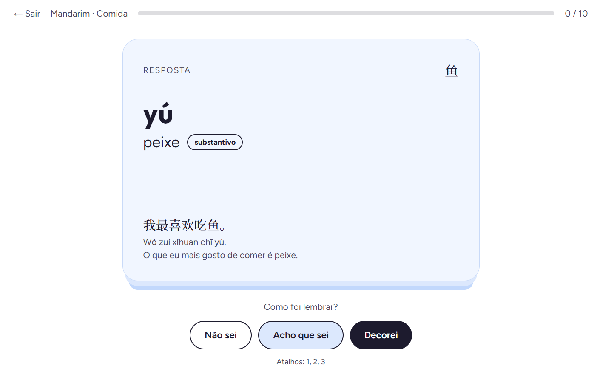

# Karta

Baralhos de flashcards de idiomas gerados por IA. Você escolhe o idioma, o nível e o tema. O Gemini monta as cartas com pronúncia, tradução e uma frase de exemplo no nível certo, e o app agenda as revisões por repetição espaçada.

> **Status:** em desenvolvimento. Geração com IA, biblioteca, modo estudo, áudio e exportação para o Anki funcionando. Próxima etapa: publicar online. Acompanhe pelo [diário de construção](docs/processo.md).

| Baralho gerado pelo Gemini | Modo estudo |
|---|---|
|  |  |

## Origem
O Karta começou como uma nova interface para o [Agente_Flashcards_Mandarim](https://github.com/SanchesPinto/Agente_Flashcards_Mandarim), pipeline em Python de **Gabriel Pinto** (OpenAI, Pexels, edge-tts e genanki). O escopo vem desse projeto: cartas com pinyin e frase de exemplo, áudio separado para palavra e frase, exportação para o Anki e, numa branch de junho/2026, suporte a inglês e francês com configuração por idioma.

O código original do Gabriel está preservado em [`v1-python/`](v1-python), com o histórico completo dos commits dele neste repositório. O Karta reescreveu a implementação do zero como app web, sem reaproveitar código: trocou os provedores pelo Gemini, chegou a 5 idiomas e acrescentou modo estudo com repetição espaçada, modelos reserva e diagnóstico. A comparação completa está no [diário](docs/processo.md#origem-o-projeto-do-gabriel).

## Por que existe
Montar um baralho bom de vocabulário dá trabalho: escolher as palavras do nível, conferir a pronúncia e achar uma frase de exemplo que não use palavras mais difíceis que a própria carta. O Karta faz essa parte em segundos e deixa a pessoa só estudar.

## O que este projeto mostra
| Habilidade | Onde ver |
|---|---|
| Engenharia de prompt | [`lib/prompt.js`](lib/prompt.js): instrução de sistema, regras por idioma e schema de saída |
| Saída estruturada e validação | Schema JSON imposto ao modelo + [`lib/validar.js`](lib/validar.js) |
| Orquestração de modelos com resiliência | [`app/api/gerar/route.js`](app/api/gerar/route.js): novas tentativas, modelos reserva, tempo limite |
| API sem backend próprio | Rotas `/api` que viram funções serverless; cada visitante usa a própria chave, então a cota do projeto não é exposta |
| Diagnóstico de problemas reais | [`scripts/diagnostico.mjs`](scripts/diagnostico.mjs), os 6 problemas do [primeiro teste](docs/processo.md#dia-2-1411-as-telas-e-o-primeiro-teste-real) e o [chiado causado por um certificado C2PA](docs/processo.md#dia-2-à-tarde-1411-áudio) |
| Do design ao produto | [Mockups](docs/design) que viraram as telas reais |
| Testes automáticos | [`scripts/testar-apkg.mjs`](scripts/testar-apkg.mjs): gera um `.apkg` de exemplo e confere 10 pontos do formato |

## Como funciona

```
Navegador                    Servidor (função serverless)                 Gemini
─────────                    ────────────────────────────                 ──────
Formulário ── POST ──▶  /api/gerar
                        1. valida o pedido
                        2. monta o prompt  ──────────────────────────────▶ modelo principal
                           (se sobrecarregado: espera e tenta de novo;     │ ou reserva
                            depois passa para o modelo reserva)            │
                        3. recebe o JSON   ◀───────────────────────────────┘
                        4. remove cartas repetidas ou incompletas
Salva no   ◀── JSON ──
navegador
    │
    ▼
Estudo: a repetição espaçada decide quando cada carta volta
```

## Decisões principais

| Decisão | Por quê |
|---|---|
| Gemini | Camada gratuita, texto e voz no mesmo provedor |
| Modelos em variáveis de ambiente | Modelos são aposentados e ficam sobrecarregados. Trocar não exige mexer no código |
| Erro 503 e falha de rede: nova tentativa. Erro 401 e 429: para | Só repete o que esperar resolve |
| `localStorage` em vez de banco | MVP sem login. Limite: os dados ficam num navegador só |
| Repetição espaçada própria | Regra simples e explicável: errou, volta na hora; acertou com segurança, o intervalo cresce 2,5× |

## Usando sem instalar
No site publicado, abra o **baralho de exemplo** direto na biblioteca. Para criar os seus baralhos, cole a sua chave gratuita do Gemini em **Configurações**: ela fica só no seu navegador. Detalhes da decisão no [diário](docs/processo.md#preparando-para-publicar-de-quem-é-a-chave).

## Como rodar

Pré-requisitos: Node.js 20 ou mais novo e uma chave do Gemini ([aistudio.google.com/apikey](https://aistudio.google.com/apikey)).

```bash
npm install
cp .env.example .env.local      # coloque sua chave em GEMINI_API_KEY
npm run diagnostico             # confere a chave e mede quais modelos estão respondendo
npm run testar:apkg             # testa a exportação para o Anki
npm run dev
```

Abra http://localhost:3000.

## Estrutura

```
app/
  page.jsx                     Biblioteca
  novo/page.jsx                Novo baralho
  baralho/[id]/page.jsx        Lista de cartas
  baralho/[id]/estudar/        Modo estudo
  api/gerar/route.js           Função serverless que gera as cartas
  api/voz/route.js             Função serverless que gera o áudio
components/BotaoAudio.jsx      Ouvir (Gemini ou voz do navegador)
lib/
  prompt.js                    Prompt e schema
  idiomas.js                   Regras por idioma (usadas pelo prompt e pelas telas)
  validar.js                   Validação do pedido e da resposta
  repeticao.js                 Repetição espaçada
  armazenamento.js             Baralhos no navegador (localStorage)
  audios.js                    Áudios no navegador (IndexedDB)
  gerarAudios.js               Geração dos áudios, uma carta por vez
  wav.js                       PCM para WAV e remoção do certificado C2PA
  apkg.js                      Montagem do pacote do Anki
  exportarApkg.js              Exportação no navegador
scripts/
  diagnostico.mjs              Teste de chave e de modelos de texto
  diagnostico-voz.mjs          Teste dos modelos de voz
  testar-apkg.mjs              Teste automático da exportação
  copiar-sqljs.mjs             Copia o SQLite para public/ no npm install
v1-python/                     Projeto original do Gabriel Pinto (Python), preservado
docs/
  processo.md                  Diário de construção
  design/                      Mockups originais
  screenshots/                 Prints do app
```

## Próximos passos
- Deploy no Vercel, para usar sem instalar nada
- GIF do app funcionando

## Como foi feito
Construído com IA de ponta a ponta, a partir do projeto de Gabriel Pinto (veja [Origem](#origem)): mockups gerados com uma ferramenta de design com IA; código escrito com o Claude como agente, a partir das minhas decisões de produto e dos meus testes; Gemini como motor do produto. Detalhes no [diário](docs/processo.md).
